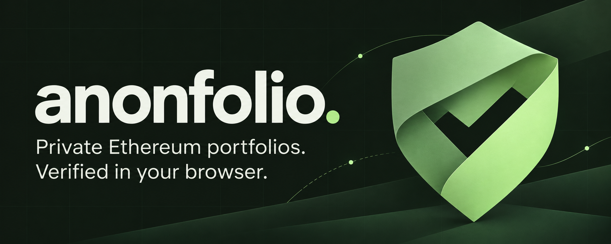
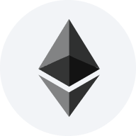

# Anonfolio

A browser-verified Ethereum mainnet portfolio tracker, built for IPFS. Track named addresses, ETH/WETH and custom ERC-20s without connecting a wallet.

**Tor via Anon-RPC is the default.** Helios verifies balances locally against finalized Ethereum state. Optional **Direct HTTPS** exposes your IP to providers; the app never switches automatically.

<!-- portfolio-screenshot -->


<!-- /portfolio-screenshot -->

[More screenshots](screenshots/README.md)

## Run locally

Install [Bun 1.3.14](https://bun.sh/), then:

```sh
bun install --frozen-lockfile
bun run dev
```

Open **http://127.0.0.1:5173**. To build and serve the production app:

```sh
bun run build
bun run serve
```

Open **http://localhost:4173**.

## Use

- Click **+** to add one or more addresses. Manage tokens, icons, pricing and network settings with the top-right gear.
- Refresh each address independently. Saved balances reopen without automatic refresh; failed reads retain previous values with stale indicators.
- View token totals and 30-minute Uniswap v3 TWAP estimates in USDC or a custom quote token. Assets without a qualifying direct pool stay unpriced, and totals are marked partial.

The default Tor gateway is a development demo. A recent trusted checkpoint and compatible RPC endpoints are required; see [network and trust setup](docs/documentation.html#configuration-builds-and-publishing).

## Technologies

| Technology | Role |
| --- | --- |
|  [Bun](https://bun.sh/) ·  [Vite](https://vite.dev/) ·  [TypeScript](https://www.typescriptlang.org/) | Static UI, builds and local tooling. |
|  [Tor](https://www.torproject.org/) · [Anon-RPC](https://github.com/ethereum/anon-rpc) | Private requests with per-address isolation. |
| [Helios 0.12.0](vendor/helios/README.md) · WebAssembly/revm · EthereumJS Trie | Consensus, proofs and local contract execution. |
|  [Ethereum](https://ethereum.org/) ·  [viem](https://viem.sh/) | Mainnet data, ABI utilities and bigint arithmetic. |
|  [Uniswap v3](https://docs.uniswap.org/contracts/v3/overview) | Direct-pool TWAP price estimates. |
|  [IPFS/Kubo](https://docs.ipfs.tech/) · Docker | Static publishing, CID checks and CAR exports. |
|  [Playwright](https://playwright.dev/) | Browser tests. |

[Artwork credits](src/assets/technology/README.md)

## Tests

```sh
bunx playwright install chromium
bun run test:all
```

For real-provider tests, Windows setup and screenshot regeneration, see the [testing guide](docs/documentation.html#testing-and-maintenance).

## IPFS deployment

Publish the complete `dist/` directory to IPFS, preferably through an HTTPS subdomain gateway. Each release has an immutable CID; a new CID/origin does not automatically carry over saved portfolios.

<!-- ipfs-build -->
**IPFS build:** [ipfs://bafybeig6wynwtacu6ljarm72zrhvfvmmtkmnmgy5j3zzjjncvz7ujvdbx4/](ipfs://bafybeig6wynwtacu6ljarm72zrhvfvmmtkmnmgy5j3zzjjncvz7ujvdbx4/)

Locally validated export; public availability requires pinning.
<!-- /ipfs-build -->

```sh
bun run test:ipfs   # native Kubo + Chromium; no Unix shell or Docker needed
bun run ui:docker   # Docker publishing through a reachable Kubo API
```

See [publishing](docs/documentation.html#configuration-builds-and-publishing) and [gateway deployment](deploy/tor-gateways/README.md).

## Documentation

[System guide](docs/documentation.html) · [Technical slides](docs/presentation.html) · [PDF](docs/presentation.pdf) · [Uniswap feedback](FEEDBACK.md)
