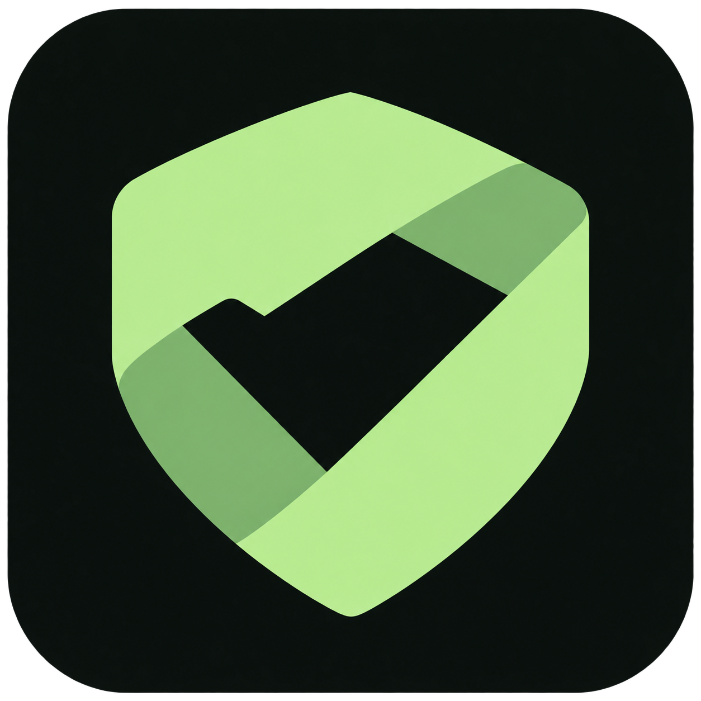
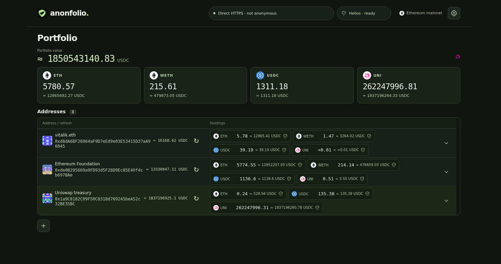

# Anonfolio



An Ethereum mainnet portfolio reader that verifies balances in your browser. Track named addresses, ETH, WETH and custom ERC-20 tokens without connecting a wallet, signing messages or sending transactions.

**Tor via Anon-RPC is the default.** Each address uses its own isolation key. You can explicitly select **Direct HTTPS (not anonymous)** in Settings; providers then see your IP and requested addresses. A Tor failure never switches to HTTPS automatically.

<!-- portfolio-screenshot -->


*Public mainnet snapshot · 6 Nov 2026 · ETH, WETH, USDC and UNI · Helios-verified over direct HTTPS. [Capture details](docs/images/README.md).*
<!-- /portfolio-screenshot -->

## Technologies

| Technology | How Anonfolio uses it |
| --- | --- |
|  **[TypeScript](https://www.typescriptlang.org/)** | Application, transport and verification orchestration, using native HTML/CSS and browser DOM APIs. No frontend framework. |
|  **[Bun](https://bun.sh/)** | Package management, scripts, unit tests and the simple static web server. Baseline: **1.3.14**. |
|  **[Vite](https://vite.dev/)** | Development server and production bundling of the page, workers and local assets. |
|  **[Tor](https://www.torproject.org/) · [Anon-RPC](https://github.com/ethereum/anon-rpc) · [tor-js](https://github.com/ethereum/tor-js)** | Private execution and consensus requests through `@anon-rpc/browser-harness`, Tor and WebRTC/KPS gateways. |
| **[Helios](https://github.com/a16z/helios) · WebAssembly · revm** | A shared consensus light client and local EVM execution with verified account/storage proofs and bytecode. Reviewed Helios **0.12.0**, including PR #813 fixes. |
|  **[Ethereum](https://ethereum.org/)** | Mainnet ETH, WETH and ERC-20 balances, pinned to a verified finalized block for each refresh. |
|  **[viem](https://viem.sh/) · [EthereumJS Trie](https://github.com/ethereumjs/ethereumjs-monorepo/tree/master/packages/trie)** | Address and ABI utilities, bigint unit formatting, and additional Merkle-proof checks. |
|  **[Uniswap v3](https://docs.uniswap.org/contracts/v3/overview)** | Estimated holding values from a 30-minute TWAP using one qualifying direct token/quote pool. USDC is the default quote. |
| **Browser APIs** | Web Workers, Web Crypto, localStorage, Web Locks and a service worker for isolation, integrity checks, safe cross-tab saving and offline application assets. |
|  **[Playwright](https://playwright.dev/)** | Chromium UI, layout, routing, offline and opt-in real-provider smoke tests. |
|  **[IPFS / Kubo](https://docs.ipfs.tech/) · [Docker](https://www.docker.com/)** | Optional static-site publishing, CID validation and CAR exports. Neither is needed to run the app locally. |

Logos identify their technologies, not endorsements. See [artwork sources and credits](src/assets/technology/README.md). The app uses the Tor logo for Tor mode, Ethereum's mark for the network, and Uniswap's mark for price methodology. All runtime artwork is local and works offline.

## Run locally

Install [Bun 1.3.14](https://bun.sh/), then:

```sh
bun install --frozen-lockfile
bun run dev
```

Open **http://127.0.0.1:5173**. Development binds to loopback and serves the pinned Tor worker as unchanged bytes; its integrity check stays enabled.

To build and serve the production page:

```sh
bun run build
bun run serve
```

Open **http://localhost:4173**. Set `HOST` and `PORT` to change the static server's bind address and port. It serves only `dist/`; it is not an RPC proxy.

The committed lockfile uses format version 1 for Bun 1.3.14 compatibility. Bun 1.4.x can install with `--frozen-lockfile`, but may rewrite the format during dependency changes. If you encounter “Unknown lockfile version,” restore the committed `bun.lock` and use the baseline Bun version.

## Track a portfolio

- Click **+** below the addresses to add an address or a list. Give one address an optional name, or paste named lines such as `Savings | 0x…`. Validation happens locally.
- Open the top-right **Settings** gear to manage tracked tokens, optional PNG/JPEG/WebP icons, quote-token pricing and network settings. ETH and WETH are included by default and use the same token controls as custom assets. Token decimals are user-supplied; the app does not call `decimals()`.
- Use the refresh button next to an address to update that address. Newly added addresses receive an initial read. Reopening the page shows saved balances and prices without automatically refreshing them.
- The overview sums holdings across addresses. Values use bigint arithmetic and display at most two decimals; tiny positive values display as `<0.01`. Current proven zero holdings are omitted from address rows. Unknown values are not treated as zero; cached or failed values remain visible with stale/unavailable indicators.
- Expand an address with its chevron for read times, verification progress, timestamped request logs and error details. **Remove address** is inside that view and requires confirmation.

Addresses, names, token settings, icons, balances and quotes remain in browser storage. Open tabs synchronize without starting reads; shared Web Locks serialize saves and merge edits so stale tabs cannot overwrite additions or resurrect removals. Safe persistence needs a current browser on HTTPS or localhost with Web Locks. Storage failures show a warning while the in-memory session remains usable.

## How reads and estimates work

1. Start the selected transport. Tor startup uses bundled, hash-pinned worker data, not an Ethereum RPC discovery request. Each watched address receives a random isolation key; shared consensus uses a separate route.
2. Helios bootstraps from a trusted mainnet checkpoint and verifies consensus. Each refresh selects one verified finalized execution block.
3. Prove ETH with `eth_getProof`. Execute ERC-20 `balanceOf(address)` locally against verified bytecode and storage, including proxy dependencies. Invalid proofs, wrong wallets/blocks, missing requested slots and tampered code fail closed.
4. In parallel, read Uniswap factory/pool data through the same verified local-call path at that block. Join a price to a holding only after its balance is proven at the matching block, then save each result with its block identity and timestamp.

Pricing uses **exactly one direct token/quote pool**, validated against the canonical v3 factory, with at least 30 minutes of history and sufficient current/harmonic liquidity. There are no multihop routes, spot-price fallbacks or external pricing APIs. ETH and WETH both use the WETH/USDC **0.05%** pool when USDC is selected. Tokens without a qualifying direct pool remain unpriced, making totals partial. Estimates are historical reference values, not executable trade quotes.

Two balance jobs and two pricing jobs can overlap within one address session. Different addresses queue through the shared verifier. Requests retain the address's isolation key across retries; RPC batches containing different addresses are forbidden. Removing an address or leaving the page cancels queued/active verification, aborts requests and ignores late messages.

Prices are shared across addresses in the running verifier. ETH and WETH use the same WETH quote: one successful lookup is reused for every address at the same finalized block and pricing settings. The first lookup needs several verified factory/pool calls, not just one HTTP request. A different finalized block requires a new quote, and restarting the verifier clears its in-memory oracle cache. Logs distinguish a new lookup from reuse.

Temporary pricing failures retry automatically for affected holdings on their existing route, even if balance verification succeeded. The retry verifies those holdings and prices together at its selected finalized block. Missing direct pools and other permanent pricing failures remain unpriced without endless retries. Error details survive reload, but reopening the app still does not start reads automatically. Tabs synchronize quote settings without starting network reads; each requested refresh keeps one pricing-settings snapshot. A late result cannot replace a holding from a newer verified block.

The [illustrated system guide](docs/documentation.html) covers the architecture, flowcharts, networking, verification, pricing, cache formats, retries and deployment in detail. It opens directly from disk or at **`/docs/documentation.html`** on either server.

The [technical presentation](docs/presentation.html) is a self-contained 16-slide deck covering the project, technology stack, worker messages, Tor/KPS networking, consensus and account/storage proofs, local ERC-20 execution, and shared Uniswap pricing. Open it directly from disk or at **`/docs/presentation.html`**. A [PDF copy](docs/presentation.pdf) is also included. Use arrow keys to present, **Notes** for speaker detail, **All slides** to read continuously, or **Print / PDF** to export. Logos, diagrams and the demonstration screenshot are embedded; the deck sends no network requests unless you follow a reference link.

After editing the slides, regenerate the committed PDF with `UPDATE_PRESENTATION_PDF=1 bun run test:browser e2e/presentation.spec.ts --grep "self-contained presentation"`, then rebuild. The test checks a 16-page PDF export; the production build includes both formats in the offline application shell.

## Privacy, trust and configuration

**Tor mode:** consensus, balance proofs, bytecode and price-oracle requests go through Anon-RPC. RPC providers see the addresses they serve, while Tor hides the browser's IP from them. Per-address isolation does not guarantee different Tor exit nodes. No analytics, remote icon services, external fonts or addresses in page URLs are used.

**Direct HTTPS mode:** verification remains enabled, but execution and consensus requests use ordinary browser fetch. The header explicitly identifies this as non-anonymous. There is no automatic switch between modes.

In **Settings → Network connection**, configure gateways and HTTPS RPC endpoints. Defaults start with dRPC, followed by PublicNode and Ankr. Operators must support historical proofs at the selected finalized block. Explicit proof-history rejections can try another configured operator with the same isolation key and block; other transport or verification failures fail closed.

The default is one development demo gateway; live Tor retrieval depends on gateway, WebRTC/UDP, Tor and provider availability. Deployment defaults can be set with `VITE_ANON_GATEWAYS`, `VITE_RPC_URLS` and `VITE_TOR_BOOTSTRAP_URL`. See [gateway deployment and directory mirrors](deploy/tor-gateways/README.md).

The consensus checkpoint must be less than 14 days old. **Settings → Consensus checkpoint** accepts a root and matching slot checked against independent trusted mainnet sources. Never replace it merely with an untrusted RPC's suggested value.

**Update Tor worker from PublicNode** is an explicit recovery action: it queries PublicNode and downloads a worker directly, without sending watched addresses. Applying it trusts PublicNode's selected worker code/digest instead of the reviewed bundled pin. Failed updates keep the existing worker. Runtime settings cannot change the pinned Helios binary.

Browser storage is not encrypted: someone with access to that origin's storage can read saved addresses and any API keys in configured endpoint URLs. The app caches application assets for offline reopening, never RPC responses. Saved balances can be shown offline; retrieving new values still requires a working connection.

## Tests

```sh
bun run test                 # unit, proof, transport, storage and build-input regressions
bun run typecheck
bun audit                    # dependency advisories
bunx playwright install chromium
bun run test:browser         # deterministic Chromium tests
bun run test:all             # unit tests, build, browser tests and static/offline checks
bun run test:live:https      # real verified ETH/WETH using explicitly selected HTTPS
bun run test:live            # real Tor/Helios balance and pricing smoke test
```

To regenerate all published screenshots from the saved, verified mainnet snapshot:

```sh
UPDATE_SCREENSHOTS=1 bun run test:browser e2e/published-screenshots.spec.ts
bun scripts/sync-screenshot-docs.ts
UPDATE_PRESENTATION_PDF=1 bun run test:browser e2e/presentation.spec.ts --grep "self-contained presentation"
```

Use `SCREENSHOT_LIVE=1` instead of `UPDATE_SCREENSHOTS=1` for a fresh mainnet capture through the real Helios verifier in explicit HTTPS mode. This updates the saved snapshot and both images; run the synchronization and PDF commands shown above to update the captions and presentation. See [screenshot provenance](docs/images/README.md).

Live tests are opt-in and depend on external services. To exercise a production build, build and start `bun run serve`, then set `BASE_URL=http://127.0.0.1:4173` when running the live command. `LIVE_BALANCE_RPC` can select an operator for the smoke test.

Tests cover wrong-wallet/block proofs, omitted nonzero storage slots, bytecode tampering, private-route escapes, cancellation and late replies, response-size limits, concurrent tab edits, quote ordering/decimals/history, zero balances, failures, offline cache behavior and loading layout stability. CI runs locked installs on Bun 1.3.14 and 1.4.3; failed browser checks retain screenshots and traces.

## Static HTTPS and IPFS deployment

Upload the complete **`dist/`** directory to a static HTTPS host. No application backend or wallet extension is required. For a subdirectory, build with `bun run build --base=/your-path/`. Serve `sw.js` with revalidation/no-cache so browsers can discover updates.

Optional IPFS commands:

```sh
bun run ui:docker            # build the image and publish through a reachable Kubo API
bun run test:ipfs            # isolated Kubo/CAR/path + subdomain gateway checks; needs Kubo
```

`IPFS_API_MULTIADDR` selects the publisher's Kubo API; the Docker default is `/dns4/host.docker.internal/tcp/5001`. The publisher checks the uploaded CID against the build CID. `scripts/export-ipfs.sh` produces `anonfolio.car` and `ipfs-cid.txt`. See the [publishing section of the guide](docs/documentation.html#configuration-builds-and-publishing) and [IPFS workflow template](.github-workflows/ipfs-deploy.yml) for export/release details. Enabling that template requires credentials with workflow-write permission.

Prefer an IPFS subdomain gateway for a separate browser origin per CID. Path gateways can share storage origins with other content; changing CIDs/subdomains does not migrate saved portfolios automatically.
