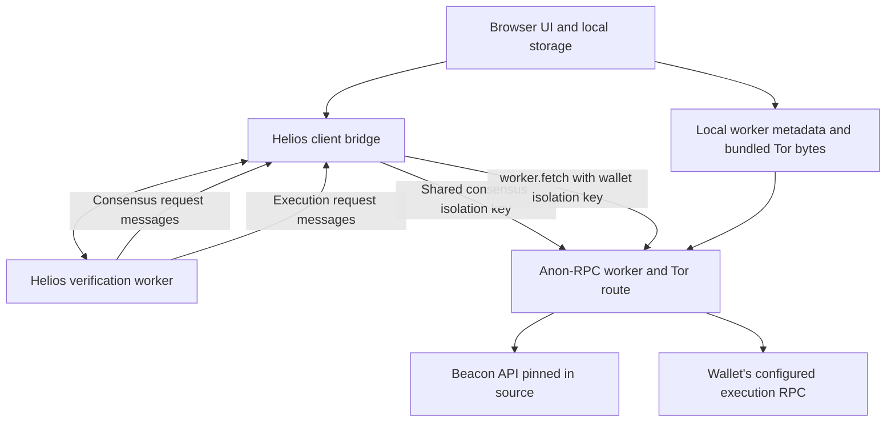

# How Anonfolio works

## Overall explanation

Anonfolio is a static, browser-based Ethereum mainnet portfolio reader. A user adds addresses to a watchlist, chooses which assets to track, and sees their balances, per-token totals, and estimated portfolio value. ETH and WETH are included initially, and other ERC-20 tokens can be added in Settings. Addresses can have names and locally generated blockie icons. The application never asks the user to connect a wallet or sign a transaction.

The application combines two separate protections. **Anon-RPC and Tor provide a private network route** for execution requests. **Helios verifies Ethereum state in the browser** so an RPC response alone cannot establish a balance. Each refresh uses one verified finalized Ethereum block, and its price estimates use that same block. Finalized state can lag the chain head; displayed results are not reads of the latest unfinalized block.

Price estimates use a 30-minute Uniswap v3 time-weighted average price (TWAP) from one qualifying direct token/quote pool. USDC is the default quote token. A custom ERC-20 quote token can be configured. Missing prices leave the corresponding assets unpriced and make the estimated portfolio total partial.

The browser keeps the watchlist, settings, icons, and previously retrieved values in local storage. A production service worker caches the application files, allowing an already visited page to reopen offline. Cached balances and estimates remain historical until a successful refresh replaces them.

There is no application backend or portfolio database. Bun runs development tools and an optional static server; Vite builds the HTML, JavaScript, CSS, images, and WebAssembly files for an HTTPS host or IPFS gateway.

## Architecture and source map

The main browser thread owns application state and rendering. It communicates with two different workers: the Anon-RPC worker supplies private networking, while the Helios worker performs consensus verification and local contract execution.



Both consensus and execution traffic use Anon-RPC. Consensus has its own isolation key and carries no watched wallet addresses. Ordinary browser HTTP loads local application assets, including the pinned Tor bundle and Helios WASM; it does not query Ethereum execution or beacon endpoints.

| File or directory | Responsibility |
| --- | --- |
| [`src/main.ts`](../src/main.ts) | Page construction, application state, event handlers, refresh orchestration, and rendering. |
| [`src/dom.ts`](../src/dom.ts) | In-place reconciliation with stable request, phase, block and error identities. |
| [`src/viewport.ts`](../src/viewport.ts) | Portfolio scroll anchoring, visible-log-tail following and open-disclosure height retention. |
| [`src/addresses.ts`](../src/addresses.ts), [`src/address-display.ts`](../src/address-display.ts) | Address/name validation and the reusable address/blockie component. |
| [`src/tokens.ts`](../src/tokens.ts), [`src/icons.ts`](../src/icons.ts) | Token definitions, validation, presets, and local icon handling. |
| [`src/connection.ts`](../src/connection.ts) | Local pinned bootstrap and lifecycle of the shared Anon-RPC worker. |
| [`src/bootstrap.ts`](../src/bootstrap.ts), [`vendor/tor`](../vendor/tor/README.md) | Local specifier metadata and unchanged hash-pinned Tor bundle. |
| [`src/config.ts`](../src/config.ts), [`src/settings.ts`](../src/settings.ts) | Deployment defaults, runtime network settings, and the Tor worker digest pin. |
| [`src/balances.ts`](../src/balances.ts) | Wallet/balance models, verification events, and amount formatting. |
| [`src/verification/client.ts`](../src/verification/client.ts) | Main-thread sessions and messages to/from the Helios worker. |
| [`src/verification/helios.worker.ts`](../src/verification/helios.worker.ts) | Shared consensus client, serialized refreshes, verified balance and oracle execution. |
| [`src/verification/transport.ts`](../src/verification/transport.ts) | The execution RPC capability that uses Anon-RPC. |
| [`src/verification/proofs.ts`](../src/verification/proofs.ts), [`src/verification/trust.ts`](../src/verification/trust.ts) | Proof/code checks, block binding, checkpoint policy, and WASM pin. |
| [`src/pricing.ts`](../src/pricing.ts) | Direct-pool discovery, qualification, TWAP calculations, quote caches, and pricing settings. |
| [`src/totals.ts`](../src/totals.ts) | Token totals and rational estimated portfolio totals. |
| [`src/errors.ts`](../src/errors.ts) | Bounded/redacted failure messages and cause-specific recovery guidance. |
| [`src/storage.ts`](../src/storage.ts), [`src/retries.ts`](../src/retries.ts) | Persistent snapshots, migrations, and retry scheduling. |
| [`vendor/helios`](../vendor/helios/README.md) | Reviewed Helios WASM, adapted JavaScript HTTP bridge, license, and review evidence. |
| [`vite.config.ts`](../vite.config.ts), [`scripts`](../scripts) | Build configuration, offline shell generation, static serving, and IPFS publishing/checks. |
| [`tests`](../tests), [`e2e`](../e2e) | Unit/adversarial tests and browser integration tests. |

## Startup and the refresh lifecycle

When the page opens, `main.ts` loads network configuration, pricing settings, and the saved portfolio. Saved values can render immediately. The application starts the Anon-RPC connection, and each restored address requests a refresh. The Helios worker is created lazily when verification is first requested.

A refresh follows this sequence:

1. Mark the address as loading and prepare per-asset activity entries. If a refresh is already running for that address, request one follow-up refresh instead of starting another concurrently.
2. Wait for the shared Anon-RPC worker to become ready. An offline browser or unavailable private connection cannot trigger a public execution fallback.
3. Create a Helios verification session containing the wallet's RPC endpoint, isolation key, selected tokens, and a snapshot of pricing settings.
4. Queue execution in the shared verifier. Synchronize consensus if needed, select a verified finalized block, and freeze its hash and state root for this refresh.
5. Verify the selected balances. Each successful asset emits its own result, which is saved and rendered immediately; another asset's failure does not erase it.
6. After the balance-reading loop finishes, attempt price estimates for the successfully read assets at the frozen block. Oracle work does not precede the other assets' balance reads.
7. Save and render the final state. Schedule recovery after a failed round; start a requested follow-up refresh immediately only after a successful round.

Addresses have independent UI state and retry schedules, but execution in Helios is **serialized across addresses**. This keeps one shared consensus client and ensures every execution request has an unambiguous wallet route. A large watchlist therefore queues work rather than executing all wallets' contracts simultaneously.

## Addresses, tokens, and the interface

Address validation happens locally before the watchlist changes. Plain lists accept whitespace, commas, or semicolons. Named lists accept `Name | 0x…`, one entry per line. Invalid input rejects the addition as a whole; valid addresses are normalized and duplicates are removed. A single-address name field is also available. Names are trimmed, limited to 80 characters, and rejected if they contain control characters.

`addressDisplay()` renders a blockie, an optional name, and the address. The blockie is an address-seeded, mirrored 8×8 SVG grid generated without a library or network lookup. Full address text stays in the DOM; CSS only clips it when the available width is too small. The component is used in table rows; expanded details do not repeat the address. Per-token activity does not repeat the address already displayed above it.

A compact + button below the tracked-address table opens the address form; it supports keyboard activation, announces its expanded state, and retains bulk/named address entry. The form is open on an empty watchlist.

The watchlist uses compact table rows with address, token balances and a details control, a refresh button beside each address, expandable details, and sticky headers/address cells. There is no separate Status column; per-token status icons remain beside balances, with queue and retry details available in the expanded pane. On narrow screens the table can scroll horizontally. A local SVG chevron opens or closes each address pane. Remove address is at the bottom of expanded details. Removing an address opens a confirmation showing its name and full address. Confirming removes it from the active watchlist and stored snapshot, cancels scheduled retries, and updates totals. It does not undo an already submitted network request.

The tracked-token list applies to every address. Native ETH is represented internally by the identifier `eth`; ERC-20 assets use their contract addresses. ETH and WETH use the same settings controls as custom tokens and can be removed and re-added. Removing all tokens preserves the address list while stopping balance reads.

Custom token configuration includes a contract address, display symbol, decimals, and optional icon. Token identity is based on the address, so two contracts with the same symbol remain distinct. The symbol is user-supplied display metadata; it is not an authenticated token name.

Icons use bundled assets or local raster uploads. Uploaded PNG, JPEG, and WebP files are limited to 1 MB, decoded in the browser, fitted into a 64×64 canvas, and saved as PNG data URLs. Missing images use a symbol badge. Remote icon URLs and uploaded SVGs are rejected. The application icon is a bundled SVG shared by the header and browser tab.

Settings open behind the top-right gear. The panel contains tracked tokens, price estimates, and network configuration, and closes with Escape, its close button, or interaction outside the panel.

## Private connection and execution transport

`Connection.get()` shares one pending startup promise and one long-lived `AnonRpcWorker`. The application bundles unchanged Tor worker bytes with its source-pinned hash. A local metadata provider answers only `workerHash()` and `workerResolvers()` for the expected specifier identity; unsupported requests are rejected rather than forwarded to an RPC. By default the only resolver is the same-origin bundled asset. The harness verifies its bytes before starting its sandbox. Startup has no chain lookup or remote resolver fallback. An unavailable or tampered bundle fails closed.

Settings → Tor worker provides an explicit public recovery path in `worker-update.ts`. **Update Tor worker from PublicNode** uses ordinary fetch to `https://ethereum-rpc.publicnode.com/`: first `eth_blockNumber`, then `eth_call` for `workerHash()` and `workerResolvers()` at that same block on the fixed Tor specifier. It cannot submit arbitrary methods or watched addresses. Download locations must be HTTPS, without credentials/fragments. The action downloads a worker directly, verifies its Keccak-256 against the discovered digest, and stores the bytes in the separate `anonfolio-user-tor-worker-v1` CacheStorage cache. It displays the hash, block, and URLs before the user saves. Download/discovery failures keep the previous selection and settings.

Saving the updated worker records its hash/resolvers/block in the network settings and reloads. Startup rechecks the cached bytes, creates a local blob URL, and supplies the selected hash and blob resolver to the harness; it performs no public lookup or remote download. Missing/corrupt cache data fails closed and points to Settings, without falling back to remote discovery. Select the bundled worker or Restore defaults to revert. Applying an update explicitly trusts PublicNode's supplied worker digest and code; it does not receive the independent review attached to the release pin. The Helios pin and consensus checkpoint are unchanged. Cached worker bytes can be evicted by the browser; update again or revert if unavailable.

Every wallet receives a random `crypto.randomUUID()` isolation key and an execution RPC endpoint. New addresses prefer an endpoint not already assigned to another address, then reuse configured endpoints when necessary. Restored addresses receive endpoint assignments from the configured list and fresh isolation keys.

Helios execution traffic is redirected to a synthetic internal URL. It never sends HTTP to that URL. Instead, the Helios worker posts an RPC message to the main thread, which calls:

```ts
worker.fetch(wallet.rpcUrl, {
  method: 'POST',
  headers: { 'content-type': 'application/json' },
  body: JSON.stringify(request),
  signal: AbortSignal.timeout(90_000),
  anonOptions: { isolationKey: wallet.isolationKey },
});
```

The transport allows only `eth_getProof`, `eth_getCode`, `eth_getBlockByHash`, and `eth_getBlockByNumber`. It rejects batches and other execution methods, checks HTTP/JSON-RPC success and response IDs, and reports provider rejection codes/messages. The worker separately requires proof and code requests to reference the pinned block hash.

Contract calls execute locally rather than using remote `eth_call`. Requests for remote access-list hints receive a synthetic unsupported-method response, allowing Helios to demand-load proven dependencies instead. Retries retain the wallet's endpoint and isolation key. There is no automatic switch to ordinary browser fetch when a private read fails.

The RPC operator still receives the account, code, and storage queries it serves. Isolation keys separate Tor circuits/TLS sessions, but do not promise different exit nodes. The beacon provider receives consensus requests through Tor on a separate shared isolation key. Consensus can continue syncing outside an active wallet session using that route. It is never sent with a wallet’s isolation key or through ordinary browser fetch. Wallet names stay local, and the app adds no analytics or wallet-address URL parameters.

## Consensus and balance verification

### Establishing a trusted finalized block

The verifier vendors Helios `0.12.0`, including the requested-address and requested-slot checks described in its [review documentation](../vendor/helios/README.md). Before initializing WASM, the application downloads the bundled binary and checks its SHA-256 against the source pin.

One consensus light client starts from the independently reviewed release-pinned mainnet checkpoint by default. Settings → Consensus checkpoint can replace it with a user-trusted finalized beacon block root and matching slot. Helios verifies sync committee signatures and finalized headers. The HTTP adapter permits consensus GET requests only to the source-configured beacon origin and an allowed set of beacon/configuration paths. The worker posts them to the main-thread bridge, which uses Anon-RPC with the consensus isolation key and returns the response to Helios. This bridge handles background requests even when there is no active wallet session.

The release default root, slot, and timestamp live in `verification/trust.ts`. A custom root and slot are validated and saved with browser network settings; older saved settings without a checkpoint keep the release default. Save settings and reconnect reloads the page and creates a fresh shared verifier, so an old consensus session cannot survive a checkpoint change. The UI rejects malformed roots, invalid slots, and checkpoints older than 14 days or more than one minute in the future. The verifier independently repeats those checks on each refresh. Age is computed from the mainnet beacon slot. The bootstrap response must contain the selected slot, and Helios verifies that header against the selected root, preventing an old root from being relabelled with a recent slot. A custom root is a user-chosen trust anchor: compare root and slot across independent trusted mainnet sources; the application does not discover or authenticate the choice for you. Each selected execution block must have valid hash/root fields and a timestamp no more than one hour old or more than one minute in the future. Restore defaults returns to the release-pinned checkpoint, which can itself expire. Binary pins still require a reviewed source update; see the vendored review for release checkpoint evidence and binary hashes.

Each refresh freezes the resulting block hash, number, state root, and timestamp. Different wallets or later refreshes can use different finalized blocks, which is why aggregate displays explicitly identify mixed-block data.

### ETH account balances

For native ETH, Helios retrieves the account proof and verifies the account against the finalized state root. The adapter also checks that the proof belongs to the requested address and that its account fields match the proven trie value. A genuine exclusion proof can establish an absent, zero-balance account; a missing or invalid response cannot establish zero.

### ERC-20 balances and decimals

For WETH and custom ERC-20 tokens, Helios runs `balanceOf(wallet)` in its local EVM at the pinned block. It loads contract bytecode and required storage as execution discovers them. Bytecode hashes must match proven account code hashes, and storage values must match Merkle proofs under the corresponding storage root.

This approach does not assume a token's balance mapping lives at a particular slot. Proxy implementation code and storage dependencies follow the same verified execution path. Every requested storage slot must be present in the proof response, preventing an omitted nonzero slot from being interpreted as zero.

Token and quote decimals are always configured display metadata. The verifier executes only `balanceOf(wallet)` for token balances; it never calls `decimals()`, and pricing does not make metadata calls either. Built-in ETH/WETH default to 18 decimals and the USDC quote defaults to 6. Configured decimals control display and token totals even when a legacy cache contains different on-chain decimal metadata. Balance authenticity still comes from the finalized account/storage proofs and local EVM execution; decimal precision comes from the user's settings. Cached price estimates are eligible only when their quote precision matches the current configuration.

### Result and error messages

`verification/client.ts` assigns session IDs and relays progress, asset starts, balances, prices, and failures. Parallel execution requests are labelled by their actual RPC method and destination rather than attributing shared WASM transport events to whichever token started most recently. `balances.ts` applies these events to wallet state. A successful balance stores its raw bigint amount, retrieval time, verified block metadata, and configured decimals.

Each failed asset retains its own error message, failed step, and attempt timestamp, so later progress or another asset's error cannot replace its cause. A short explanation next to the balance opens Details with a styled error card: a clear title, recovery guidance, and compact endpoint/time metadata. Raw errors and distinct failed steps are tucked behind Technical details; repeated transport error text is omitted from the stage. There are no settings shortcut buttons in these cards. Wallet progress text appears only while verification is active, so completed failures do not retain a misleading consensus status above the cards. These failure records survive reloads, including failed first reads with no amount, and clear when that asset is successfully verified. Errors that echo endpoint URLs have credentials, paths, and query strings redacted before display/storage. If an older snapshot has no recorded reason, the UI says so and asks for a refresh to capture one.

Transport errors retain context both while opening the request and while consuming the response body. An interrupted JSON/beacon stream identifies the method and destination instead of surfacing a bare `Failed to fetch`; local WASM download failures identify the application host. Error cards label consensus, execution RPC, and application destinations separately, and omit an endpoint for legacy generic fetch failures whose destination is unknown. Active progress above historical failures is labelled as a retry so it cannot be mistaken for the recorded failed step.

Tor startup retains the two most recent warning/error messages in memory, with URL credentials and paths redacted and each message bounded to 350 characters. Bootstrap failures and timeouts include those diagnostics on separate lines; the compact header shows only the connection state and a retry action on failure. Failure causes and retry scheduling are available on hover, while detailed progress and Tor diagnostics stay in each address’s retrieval log and failure reports. The header has no worker-log text or Details dropdown; gateway addresses remain available in Settings → Network connection. Structured worker error records preserve nested causes and error codes. Private request failures identify the requested method and endpoint hostname; they never trigger a direct-network fallback. Successful reconnection clears connection errors, while each asset keeps its last failure until its next successful verification.

The Tor `tor_memquota` warning about unavailable total memory means system-memory detection failed and Tor selected a fallback quota. In a browser/WASM environment this is expected when the underlying OS query is unavailable. The quota controls when tracked data is reclaimed; it is not an immediate allocation, a minimum RAM requirement, or a measurement of the whole application’s memory use. See the [Tor quota implementation](https://tpo.pages.torproject.net/core/doc/rust/private/src/tor_memquota/config.rs.html).

Compact balance statuses sit inline with the amount and price estimate, using local SVG icons with native hover tooltips and accessible labels. The shield/check means verified finalized state (the tooltip explicitly identifies proven zero); saved/stale, unavailable/unverified, and missing-price states use distinct icons. Error-detail icons still open the full failure report. Counts, retry times, numeric prices and detailed progress/errors retain text.

The UI distinguishes a proven zero, an unavailable first read, an unverified legacy value, and a stale value retained after failure. Failed verification never creates a new trusted amount. Fatal worker failures terminate the shared worker and reject the active session, while queued addresses remain available for the next verifier. The main thread queues sessions and starts only one at a time. Queued addresses show Queued without a spinner or active timeout. Each active session has a five-minute deadline; time waiting in the queue does not consume it. Network reads and local WASM downloads have separate hard 90-second deadlines covering headers and the entire response body, even if the underlying transport ignores abort. Transport failure or an active-session timeout ends that attempt, terminates the affected verifier, cancels outstanding bridge requests and releases the next queued address. Late events from an obsolete worker are ignored. A completed failure clears wallet/token spinners and re-enables refresh; scheduled retries show a retry status without spinning. Successful results remain available if later asset reads fail.

After selecting a verified finalized block, the worker starts two bounded lanes in parallel: one balance proof/local balanceOf at a time and one token’s oracle work at a time. Both lanes use the same wallet isolation key and frozen block. Pricing does not need the holding amount; it can finish before that balance proof. Early quotes remain in memory until a successful balance result with the same block hash arrives. Failed balance proofs never gain a holding value from an early quote, and quotes from another block are discarded. Normal oracle failures do not block the balance lane. A rejected private transport, proof, or code witness fails the shared attempt closed and cancels both lanes; amounts already proved remain available. The progress panel marks Balances and Prices active together, then shows whichever lane is still running.

Each address also has a collapsed Retrieval log. It records application connection messages, verifier/consensus progress, private request submission and response-header/body stages, block selection, balance/price results, failures and retry scheduling. Every entry has a local timestamp with milliseconds and an exact ISO datetime; the time tooltip includes the date and timezone. The stream keeps chronological history across refresh attempts in the current browser session, independently of the latest status line. Multiline failure messages are split into separate timestamped entries, so each retained Tor diagnostic has its own row. Logs are not persisted or sent to analytics. Up to 1,000 entries per address are retained, with an explicit omitted-entry count when older entries are pruned. URL credentials and paths are redacted; request bodies and isolation keys are never serialized into log entries. Rows are created only when the disclosure is open. The log uses the portfolio’s scrollbar, with no separate fixed-height scrolling box. New entries follow only when its latest row was visible in both the portfolio and the browser viewport; reading earlier rows preserves that row’s on-screen position. Open/scroll/focus state survives progress rendering.

The Read history disclosure groups tokens by their verified finalized block hash. Each compact block card shows the finalized block number/time once and a table of per-token last successful read times. Block hashes are retained internally for verification and grouping, without a separate hash display. Different blocks have separate cards; legacy unverified saves and tokens without a successful read have distinct groups. Timestamp elements retain exact ISO datetimes and local time-zone tooltips.

The portfolio owns vertical scrolling. Address details, request previews and log entries flow inside it without creating additional vertical scroll containers. The detail pane uses the portfolio’s container width, so scrolling token columns horizontally does not make details wider than the visible area. Scrollbar gutters are reserved on the document and portfolio to prevent width changes when scrollbars become necessary, following the [CSS Overflow specification](https://www.w3.org/TR/css-overflow/).

The progress summary stays mounted and keeps its dimensions after completion, failure and automatic retry. It shows no active timer or current stage when no request is running. At most two active requests are previewed in fixed-size rows; additional requests and full status text remain available in Retrieval log, with hover text on shortened previews. Per-token activity rows reserve their indicator slot and text height. Read errors and Read history use collapsed disclosures, so newly arriving proofs or errors do not insert large blocks above the current progress. A balance’s error icon opens its report directly. An open disclosure retains its measured height until closed to prevent collapsing beneath the reader when an error clears.

Progress rendering reconciles existing DOM nodes by semantic identity: address, token, request ID, verification step, finalized block hash, error asset/kind and log sequence. The viewport restores the visible record rather than merely restoring an old scrollTop; content added above an older log entry therefore does not move that entry on screen. Token-history anchors also follow the same wallet/asset when a newly proved balance moves into another finalized-block card. Existing keyboard focus and open disclosures remain intact. Large balances and quote values stay on one line with full values available on hover instead of wrapping and changing card/row heights.

The layout regression suite reproduces and covers these causes:

| Cause | Correction |
| --- | --- |
| Portfolio, details, request preview and log each constrained their own overflow | One portfolio scroll owner; no nested detail/log scrollbars. |
| New block groups/errors appeared before the progress panel | Stable progress/activity placement; history and errors expand on user action. |
| Completion removed the whole progress panel | A stable idle/failed summary replaces active content in the same slot. |
| Retry button changed the header height by 3–10 pixels | Reserve connection-header height for every state. |
| Long numbers and status text wrapped | Bounded single-line values, compact request previews and full hover/log text. |
| Matching same-class cards reused the wrong error/block nodes | Explicit semantic keys retain each report, snapshot and request, including tokens with matching symbols. |
| Restoring pixel scrollTop or following an off-screen log tail moved the reader after updates | Restore the same visible record; follow only a visible log tail. |
| Scrollbar appearance and viewport-based detail width changed available space | Stable gutters and portfolio-relative container sizing. |

Shared private-connection status appears only in the application header. Each address’s progress panel follows verifier initialization, consensus sync, balance verification, and price estimates. The compact address-row preview is blank while its details are expanded, so the current request appears in one place. Per-token activity shows token-specific phases and payloads without repeating the connection stage or endpoint on every line. Retry scheduling appears once in the activity summary. A single actionable balance-status icon conveys failures and opens the error report; saved estimates share the balance’s saved/stale indicator and retain their own tooltip. Timestamped Retrieval logs intentionally preserve historical events, including connection messages. Network identity is shown in the header, without a repeated footer. Queued addresses have a separate waiting state. Tokens awaiting their turn are marked Pending; the request preview distinguishes actual submissions and response states from each token’s planned proof operation. Actual private requests show their method, endpoint hostname, elapsed time, and remaining time before the 90-second request timeout. Response headers and body completion are separate transport events; after a response, worker messages describe signature, proof/code checks and local EVM execution. Elapsed clocks measure waiting, not completion percentages. A pending Anon-RPC fetch does not reveal whether time is spent building its route, waiting at the operator, or transporting a response, so the UI does not invent those substeps. Background consensus traffic after block selection does not replace the active wallet’s balance/pricing progress. Worker readiness means the private worker started; the harness does not expose live Tor circuit-building progress or guarantee that an individual endpoint is reachable.

## Direct-pool TWAP estimates

### Quote token and pool selection

The default quote is canonical mainnet USDC, `0xA0b86991c6218b36c1d19D4a2e9Eb0cE3606eB48`. Settings can select a custom ERC-20 quote contract and liquidity floor. Quote-token holdings are denominated at par in their own units without a pool conversion; internally this uses a ratio of one and the zero address as the pool marker.

Every other estimate uses exactly one direct Uniswap v3 pool. ETH uses WETH as its pricing asset. With USDC selected, both ETH and WETH exclusively use the 0.05% WETH/USDC pool, `0x88e6A0c2dDD26FEEb64F039a2c41296FcB3f5640`.

For other pairs, `TwapOracle` checks fee tiers 100, 500, 3000, and 10000, corresponding to 0.01%, 0.05%, 0.3%, and 1%. It executes `getPool(base, quote, fee)` against the canonical factory, `0x1F98431c8aD98523631AE4a59f267346ea31F984`, and checks the pool's factory, token identities, fee, active liquidity, and slot state.

The selected pool must support `observe([1800, 0])`. A canonical pool reverts if it lacks the requested history. The application derives harmonic mean liquidity over that window and requires both current and harmonic virtual quote reserves to reach the configured floor, initially 10,000 USDC. When changing quote tokens, the floor is interpreted in the new quote token's units.

Among qualifying candidates, the pool with the greatest harmonic quote-side reserve wins; its address breaks ties. Candidate prices are not blended. A token with a WETH pool but no qualifying direct USDC pool stays unpriced when USDC is selected. Changing the quote token changes the required direct pair rather than introducing a multihop route.

### Oracle arithmetic and holding values

The mean tick is calculated from the signed cumulative tick difference divided by 1,800 seconds, rounding negative non-integral results down. The implementation handles the oracle accumulators' wrapping widths. The tick represents a geometric average price, rather than an arithmetic average of spot prices.

`tickRatio()` computes the raw token1/token0 ratio corresponding to `1.0001^meanTick` using bigint exponentiation with 512 fractional bits. Token ordering determines whether the ratio or its inverse converts the base asset into the quote asset. Pool ratios describe raw token units, so multiplying a raw balance by the ratio handles differing base/quote decimals without first converting balances to floating-point numbers.

Holding values remain bigint fractions:

```text
holding value in raw quote units = raw balance × numerator / denominator
```

The portfolio adds these fractions and reduces them before display conversion. The overview presents a prominent portfolio value with separate priced-holding coverage and tooltip icons for partial, stale and mixed-block results. Each token card also computes its own quote-currency subtotal across addresses using the same rational aggregation. It adds each holding’s value at its own verified block/quote rather than applying one address’s price to the aggregate token quantity. A token with no usable quotes shows an unavailable amount; incomplete per-token pricing is explicitly marked partial. The selected quote token and its configured decimals apply to the portfolio and all subtotals. The 30-minute TWAP explanation is available through a methodology icon rather than a long summary sentence. Display rounding of an individual holding never feeds back into the aggregate. The virtual reserve checks use in-range liquidity and square-root prices; they are liquidity filters, not measurements of total TVL or guarantees of proceeds from selling the holding. Estimates exclude swap fees, price impact, and slippage.

### Cache and failure behavior

Oracle execution runs alongside the balance loop through the same local EVM, pinned block, and wallet transport. No external price API or public execution shortcut is involved.

`TwapOracle` keeps two bounded in-memory maps, each limited to 128 entries: pool data keyed by pool/window/block hash, and selected pools keyed by base/quote/window/block/liquidity floor. Cached raw liquidity is normalized again when quoting a pool in reverse. Successful estimates are also stored with their balances for historical display. Qualification failures are not cached as quotes.

An estimate can be displayed only when its quote address, block hash, window, and liquidity setting match the active settings and balance. Changing pricing settings clears stored estimates and refreshes wallets. A missing pool, short history, insufficient liquidity, or failed private request leaves the holding **Unpriced** without invalidating its proven balance. Oracle-only failures currently require a manual refresh; the balance retry scheduler is driven by balance failures.

## Totals and number formatting

`portfolioTotals()` sums raw bigint balances separately for each token contract/native identifier. It records coverage, stale values, loading state, block hashes, and configured decimals. Unknown balances are excluded and make coverage partial. Conflicting decimals suppress the token amount total instead of adding incompatible units. Cached or failed historical values can be included with stale indicators.

`estimatedTotal()` sums usable holding-value fractions in the configured quote token. It reports the number of priced holdings, marks missing prices as partial, labels mixed finalized blocks and stale values, and suppresses the displayed amount if quote decimals conflict across snapshots.

`formatBalance()` formats values with at most two decimal places using integer arithmetic. It removes trailing zeros and shows a positive amount below 0.01 as `<0.01`. Native token amounts keep their full precision in storage. Estimated values are converted from their rational representation only on the display path, using additional fractional precision before formatting.

## Persistence, offline use, and retries

| Storage key | Contents |
| --- | --- |
| `anonfolio.portfolio.v2` | Current version-3 portfolio snapshot: token definitions/icons, named addresses, balances, finalized provenance, and successful estimates. |
| `anonfolio.wallets.v1` | Legacy address-only watchlist, consulted when migrating an installation without a current snapshot. |
| `anonfolio.network.v1` | Browser-local network overrides, including complete configured endpoint URLs. |
| `anonfolio.pricing.v1` | Quote-token configuration and minimum quote-side liquidity. |

The portfolio storage key retains its older name for migration. Bigint amounts are serialized as decimal strings. Loading validates addresses, token definitions, amounts, timestamps, block metadata, and estimate fields; malformed entries are ignored. Older portfolio formats migrate to the current token/balance structure, and explicitly removed defaults remain removed.

Isolation keys and request payloads are not persisted. Saved values are restored as cached, and legacy entries lacking block provenance require verification. Successful results and watchlist edits save immediately. A blocked or full localStorage leaves the current in-memory session usable and displays a storage warning. The stored portfolio and any credentials in network-setting URLs are accessible to someone with access to that browser origin's storage.

The bundled Tor worker is cached as a local application asset, and is still hash-checked by the harness when loaded. The production service worker is generated by `vite.config.ts`. It caches an explicit list of built application files, including the WASM binary, and removes older application-shell caches on activation. Navigation tries the network and falls back to cached HTML; other shell assets use the cache first. Requests outside that exact asset list, including RPC and worker/gateway traffic, are not intercepted. The first visit still requires a connection, and offline startup cannot retrieve new balances.

`RetryQueue` maintains one scheduled attempt per address or connection key. Failed balance rounds use delays of 2, 4, 8, 16, 32, then at most 60 seconds. Private-worker reconnects use 2, 4, 8, then at most 10 seconds between attempts. Automatic recovery selects failed or not-yet-verified balances, keeping successful results. Going offline pauses timers; coming online resumes pending work. Manual refresh resets the backoff, and removing an address cancels its scheduled retries. Leaving the page pauses retries and closes the private connection.

An execution HTTP attempt has a 90-second timeout, worker readiness has a 30-second timeout, and a verification session has a five-minute timeout. After a startup timeout, the app closes that worker before retrying and ignores late readiness from old attempts. The pinned Tor worker’s internal per-guard backoff (such as 2m 30s) is separate and is not configurable through the exposed harness API; reconnecting retains its persisted guard selection and other Tor state. These bounds keep unavailable routes from waiting indefinitely, although queued work and retries can still make a large refresh take time.

## Configuration, builds, and publishing

Deployment defaults come from `VITE_ANON_GATEWAYS` and `VITE_RPC_URLS`, with source defaults in `config.ts`. Browser network settings override those defaults after local validation. The default balance endpoint order starts with dRPC, followed by PublicNode and Ankr. The old `bootstrapRpc` storage property and `VITE_BOOTSTRAP_RPC` variable are ignored; saving settings removes that obsolete field while preserving gateway/RPC choices.

Saving network settings closes the old Anon-RPC worker and reloads the page, replacing wallet routes together. Restoring network defaults removes that override rather than clearing the portfolio or pricing configuration. Saving pricing settings instead updates the pricing configuration and refreshes the current wallets without a page reload.

An RPC must support proofs and code queries at the selected finalized block, including EIP-1898 block-hash parameters. A provider whose historical proof window is too short can reject valid requests. An explicit eth_getProof JSON-RPC history/window/pruned-state rejection triggers a bounded switch among the configured execution endpoints. The exact request, pinned finalized block and wallet isolation key remain unchanged, and every attempt still uses worker.fetch. The active session shares its rejected-endpoint set between concurrent balance and pricing reads, so they converge on a usable operator without loops. Later execution requests and refreshes prefer the replacement operator within the browser session. The UI request destination, worker progress and retrieval log identify the switch. No alternate endpoint is tried for a timeout, malformed response, generic RPC error or invalid proof; those failures still stop verification. If the configured endpoints cannot provide the required proofs, the application fails closed, retains unavailable/stale states and asks the user to configure a historical-proof-capable RPC. It never changes to latest/unfinalized state to satisfy a provider’s shorter window. Tor/WebRTC gateway connectivity is also required. The shipped Tor gateway is a development demo, and a deployment can configure its own gateway. The checkpoint can be overridden in Settings using a trusted root and matching slot. The Helios WASM pin remains source-controlled. Tor uses the release pin by default; the explicit Settings updater can apply a PublicNode-supplied digest and downloaded worker.

Use the repository's Bun 1.3.14 baseline for dependency changes and its compatible committed lockfile:

```sh
bun install --frozen-lockfile
bun run dev
bun run build
bun run serve
```

The production build type-checks TypeScript and emits `dist/`. `bun run serve` serves that directory at port 4173 by default, with `HOST` and `PORT` overrides. It accepts GET/HEAD, rejects path traversal and writes, and supplies no RPC proxy. Vite's dependency configuration also supplies an empty browser environment for the trie library's debug check and prebundles the worker dependency, avoiding a Node `process` reference during development.

Relative asset URLs allow the same build to load beneath an IPFS path or a subdomain gateway. The Docker publisher builds the site, computes a directory CIDv1, publishes/pins the directory to a configured Kubo API, and rejects a returned CID that differs from the build CID. The export script similarly checks the CID before writing a complete CAR and CID text file. `bun run ui:docker` invokes this flow; it requires an existing Docker engine and reachable Kubo API. It does not select a remote pinning service.

An [IPFS release workflow template](../.github-workflows/ipfs-deploy.yml) is supplied separately from active workflows. A subdomain gateway gives each CID a separate browser origin; path gateways can share an origin with other applications. Consequently, localStorage and service-worker behavior depend on the chosen gateway origin, and moving to another CID/subdomain does not automatically migrate saved settings or wallets.

## Testing and maintenance

The tests cover separate boundaries rather than treating mocked UI results as evidence of real proof verification:

| Command | What it checks |
| --- | --- |
| `bun run test` | Unit tests for parsing, storage, retries, totals, pricing, static serving, and adversarial proof/transport behavior. |
| `bun run typecheck` | TypeScript checking. |
| `bun run check` | Unit tests, type checking, and the production build. |
| `bun run test:browser` | Deterministic Chromium UI scenarios and a real browser-worker proof regression. UI fixtures replace connection/verifier boundaries where appropriate. |
| `bun run test:static` | Production page loading and offline recovery, after building. |
| `bun run test:all` | Unit tests, build, deterministic browser scenarios, and production/offline checks. |
| `BASE_URL=http://127.0.0.1:4173 bun run test:live` | Opt-in real Tor/Helios mainnet balances and TWAPs against a built page. The runner starts the static server if needed. |
| `bun run test:ipfs` | Real local Kubo publishing, CID/CAR checks, and path/subdomain gateway browser scenarios. `LIVE_RPC=1` also enables the live mainnet case. |

Install Chromium with `bunx playwright install chromium` before browser tests. `LIVE_BALANCE_RPC` can select a specific execution endpoint for the live smoke test. Live checks depend on external gateway/RPC availability and remain separate from deterministic CI checks.

Adversarial tests use generated trie proofs to reject a valid proof for the wrong wallet/block, omitted nonzero storage slots, forged storage values, and tampered bytecode. Transport tests reject public execution fallbacks and verify wallet isolation keys. Pricing tests cover ordering, decimals, ETH/WETH equivalence, history and liquidity failures, direct-only pool selection, reverse cache use, and unpriced WETH-only assets. Browser tests cover persistence, confirmation/cancellation, settings changes, partial estimates, failure recovery, and compact/mobile layouts.

The active GitHub Actions workflow runs the deterministic suite on Bun 1.3.14 and 1.4.3 and retains browser failure artifacts. Before changing Helios, review proof binding, local execution, transport, and background-task behavior, then update the binary pins and review evidence and rerun adversarial/live checks. Checkpoint renewal requires an independently checked root and matching slot, supplied in Settings or through a reviewed release; changing an RPC endpoint cannot renew an expired trust anchor.
