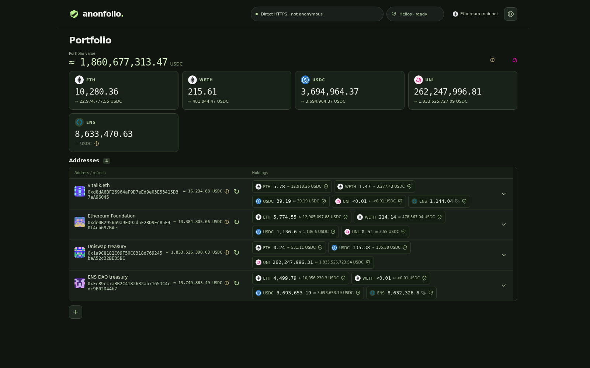

# Anonfolio screenshot gallery

Ten real application screenshots featuring publicly identified Ethereum mainnet accounts, ETH/WETH and custom USDC, UNI and ENS tokens. These are browser captures of the application, with no invented balances or prices and no pixel retouching.

[](01-public-mainnet-portfolios.png)

| Screenshot | What it shows |
| --- | --- |
| [01 · Public mainnet portfolios](01-public-mainnet-portfolios.png) | Four named accounts, combined token totals and USDC estimates. |
| [02 · vitalik.eth](02-vitalik-eth.png) | ETH, WETH, stablecoin and governance-token holdings. |
| [03 · Ethereum Foundation](03-ethereum-foundation.png) | The Foundation's publicly labelled address with ETH/WETH and custom ERC-20s. |
| [04 · Uniswap treasury](04-uniswap-treasury.png) | The governance treasury's substantial UNI balance and its USDC estimate. |
| [05 · ENS DAO treasury](05-ens-dao-treasury.png) | ETH, USDC and ENS governance-token holdings. |
| [06 · Custom ERC-20 tokens](06-custom-erc20-tokens.png) | Tracked-token settings with contract addresses, configured decimals and local icons. |
| [07 · Finalized balance history](07-finalized-balance-history.png) | The Foundation's verified finalized block and successful-read timestamps. |
| [08 · Local verification log](08-local-verification-log.png) | Real timestamped proof, bytecode and price-oracle execution events. |
| [09 · Tablet portfolios](09-tablet-portfolios.png) | All four accounts in the tablet layout. |
| [10 · Mobile portfolio](10-mobile-portfolios.png) | The ENS DAO treasury in the compact mobile layout. |

## Capture provenance

Captured live on **6 November 2026**, using **Helios 0.12.0** to verify finalized Ethereum headers, account/storage proofs and locally executed ERC-20 reads. The exact capture times, block hashes, raw balances, bigint price fractions, viewport dimensions and token metadata are preserved per image in [mainnet-snapshots.json](mainnet-snapshots.json). This records verified results, not full proof witnesses.

The capture explicitly selects **Direct HTTPS (not anonymous)** through dRPC/PublicNode for these public accounts. The header reflects that mode; the screenshots do not claim a Tor connection. The application's normal default remains Tor via Anon-RPC. No verification module or provider responses are mocked by the capture script; it checks that proofs were requested and that neither remote `eth_call` nor `eth_getBalance` was used.

Prices are the application's **30-minute direct-pool Uniswap v3 TWAP estimates** at the balance's verified finalized block. ENS remains unpriced because no direct ENS/USDC pool qualifies at the captured block. Its tokens are excluded from estimated values, and the UI marks the totals partial. No multihop price or invented quote is substituted. Proven zero holdings are hidden by the application's normal UI.

These are historical snapshots of selected addresses, not live quotes, complete organizational balance sheets, endorsements, or accounts owned by this project. The combined overview sums separate public accounts; it does not represent one owner's portfolio.

## Public account references

| Label | Mainnet address | Source |
| --- | --- | --- |
| vitalik.eth | `0xd8dA6BF26964aF9D7eEd9e03E53415D37aA96045` | [Public ENS/address label](https://etherscan.io/address/0xd8dA6BF26964aF9D7eEd9e03E53415D37aA96045) |
| Ethereum Foundation | `0xde0B295669a9FD93d5F28D9Ec85E40f4cb697BAe` | [Public address label](https://etherscan.io/address/0xde0B295669a9FD93d5F28D9Ec85E40f4cb697BAe) |
| Uniswap treasury | `0x1a9C8182C09F50C8318d769245beA52c32BE35BC` | [Uniswap Foundation treasury registry](https://github.com/uniswapfoundation/governance-processes/blob/main/TREASURY_ADDRESSES.md) |
| ENS DAO treasury | `0xFe89cc7aBB2C4183683ab71653C4cdc9B02D44b7` | [ENS DAO's published treasury address](https://docs.ens.domains/dao/proposals/6.39/) |

Token metadata is configured locally, as in the normal app. The ENS token is identified in [ENS's official documentation](https://docs.ens.domains/faq/); USDC/UNI references and existing icon credits are in the [published screenshot notes](../docs/images/README.md).

## Recreate with fresh mainnet data

With Bun and Playwright Chromium installed:

```sh
bun install --frozen-lockfile
bunx playwright install chromium
SCREENSHOT_GALLERY=1 bun run test:browser e2e/screenshot-gallery.spec.ts
```

In PowerShell, set `$env:SCREENSHOT_GALLERY = '1'`, run `bun run test:browser e2e/screenshot-gallery.spec.ts`, then clear the flag with `Remove-Item Env:SCREENSHOT_GALLERY`.

The opt-in capture starts/reuses the Vite development server, performs real verified reads, and writes exactly ten numbered PNGs plus `mainnet-snapshots.json` into this folder. It uses the application's ordinary controls to change the watchlist and open details/settings. Normal test-suite runs skip this network-dependent asset-generation task. Fresh data can change the displayed amounts, block numbers and pool availability.

ETH/WETH/USDC/UNI icons use the project's [existing artwork and MIT license](../src/assets/tokens/README.md). The additional ENS icon is embedded in the snapshot's local token metadata, copied from [Trust Wallet assets](https://github.com/trustwallet/assets/blob/master/blockchains/ethereum/assets/0xC18360217D8F7Ab5e7c516566761Ea12Ce7F9D72/logo.png), copyright 2019–2023 Trust Wallet, under the [same MIT license](../src/assets/tokens/LICENSE). Icons are fetched only by the opt-in capture setup and rendered from local data URLs in the app.
